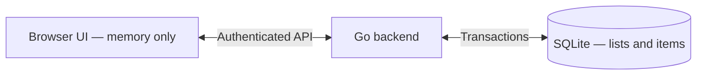

# Handlat — Private backend lists

## Direction

Shopping lists are online-only, private, and owned by an authenticated account.
SQLite is the source of truth. The browser keeps fetched list data in memory,
not in IndexedDB or another persistent browser cache.

This supersedes the original client-only, offline-first MVP plan.

## Scope and decisions

- Reuse the Go HTTP backend, SQLite, sqlc, and existing passkey sessions.
- One owner per list. Knowing a list UUID does not grant access.
- Centralize list authorization so memberships can extend the policy later.
- No sharing, invitations, offline editing, synchronization, or live updates yet.
- Start fresh: do not import existing browser lists or delete their stored data.
- New accounts start with no lists; creating a list is an explicit action.
- Refresh on navigation, window focus, and explicit retry.
- Only display edits as saved after the backend commits them.

## Architecture

Lists store an owner ID, name, and timestamps. Items store their list
ID, text, department, creation time, optional checked time, and deletion time.
Item identity is `(list_id, item_id)`. Deleted rows are retained as tombstones,
excluded from fetched items and counts, so retried additions cannot resurrect them.

## Delivery steps

1. **Database:** add list/item migrations, owner and item indexes, tombstones,
   idempotent additions, and field-level updates.
2. **Authentication and authorization:** share session validation and centralize
   the owner check. Return 401 for invalid sessions, and 404 for both missing and
   inaccessible lists.
3. **API:** create/fetch/rename lists; add/edit/check/uncheck/delete items; clear
   checked items atomically. Protect cookie-authenticated writes against
   cross-origin requests. Resolve concurrent changes using the rules below,
   without client revision preconditions or conflict errors.
4. **Frontend:** replace local document persistence with an API-backed store;
   support loading/saving/error states, explicit list creation, and direct URLs.
   Clear data on logout/account changes and ignore stale in-flight responses.
   Send only changed fields, explicit checked states, and stable addition IDs.
5. **Cutover:** stop accessing old list databases, remove unused Loro code and
   dependencies, explain the fresh start, and retain the retiring service worker.
6. **Verification:** test persistence, fresh browsers, access isolation,
   conflicting edits, expired sessions, failed saves, and offline behavior.

## API contract

All routes below are under `/api` and require a valid session.

| Method | Route | Behavior |
| --- | --- | --- |
| GET | `/lists` | Owned list summaries and item counts |
| POST | `/lists` | Create a list with `{name}` |
| GET | `/lists/{id}` | Fetch a list and its items |
| PATCH | `/lists/{id}` | Rename with `{name}` |
| POST | `/lists/{id}/items` | Add `{id, text, department?}` using a client-generated UUID |
| PATCH | `/lists/{id}/items/{itemID}` | Set supplied fields only: `{text?, department?, checked?}` |
| DELETE | `/lists/{id}/items/{itemID}` | Delete an item |
| DELETE | `/lists/{id}/checked-items` | Clear checked items |

Writes do not require `If-Match` or a client revision. Authorization, changes,
timestamps, and the returned list snapshot happen in one transaction. SQLite's
single-connection setup serializes transactions; no row-lock API or revision
counter is needed for merging. Private API responses use `Cache-Control: no-store`.

Database timestamps are integer Unix seconds, consistent with authentication
tables. The API formats item timestamps as UTC ISO strings for the frontend.
List names are trimmed and limited to 1–200 Unicode code points; item text to
1–2000. Creation and editing validate these limits before any writes, returning
400 with a field-specific message. Rejected edits leave existing data unchanged.
The database constraints remain a second line of defense.

## Backend resolution rules

| Concurrent actions | Rule |
| --- | --- |
| Separate additions | Keep both, even with identical text |
| Same addition ID retried | Keep the original; do not duplicate or overwrite it |
| Different items or fields edited | Apply both independently |
| Same field edited or list renamed | Last backend-processed value wins |
| Checking and editing text/department | Independent; editing never changes checked state |
| Check/uncheck | Explicit `checked: true/false`; backend assigns checked time |
| Delete vs. edit | Deletion wins in either order; later edits are successful no-ops |
| Repeated deletion or a missing-item edit | Successful no-op within an accessible list |
| Clear checked | Atomically delete what is checked at processing time |

For example, uncheck then clear keeps the item; clear then uncheck leaves it
deleted. Tombstones also prevent a retried addition from bringing it back.
Browser clocks never determine which edit wins. PATCH requires at least one
valid field; null is rejected. Omitted fields are never changed.

The frontend never silently retries writes or queues offline edits. A lost
response can mean a save committed: refresh to inspect server state before
trying the edit again. Refresh does not automatically replay a failed edit.
An unacknowledged addition retains its UUID in memory for explicit retries of
the same text in that list, including after refresh. After acknowledgement,
another addition of identical text gets a new UUID. Draft identity does not
survive a full reload or account change; a new draft is a new addition.

## Future streamed updates

Streaming and a durable event log/replay protocol are not implemented yet.
Choose event identifiers and reconnect behavior when that feature is designed,
rather than storing unused revisions now. Field-level commands and authoritative
snapshots remain the write model when streaming is added.

## Future sharing

Keep `lists.owner_id`. Add a membership table and invitation flow when needed,
extend the central authorization policy, and include shared lists in summaries.
Lists and items do not need a new storage model.

## Completion criteria

A user can sign in from a fresh browser and access the same private lists.
Lists survive backend restarts. Other accounts cannot read or edit them, even
when they know list/item IDs. Offline and failed operations are never presented
as successfully saved.
